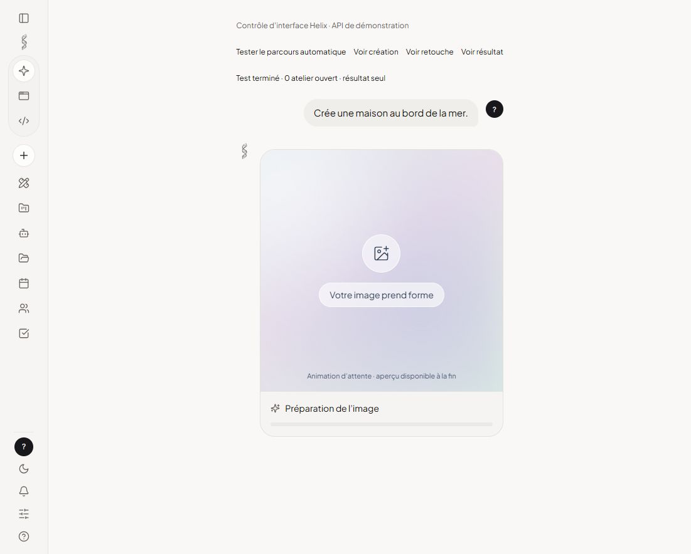
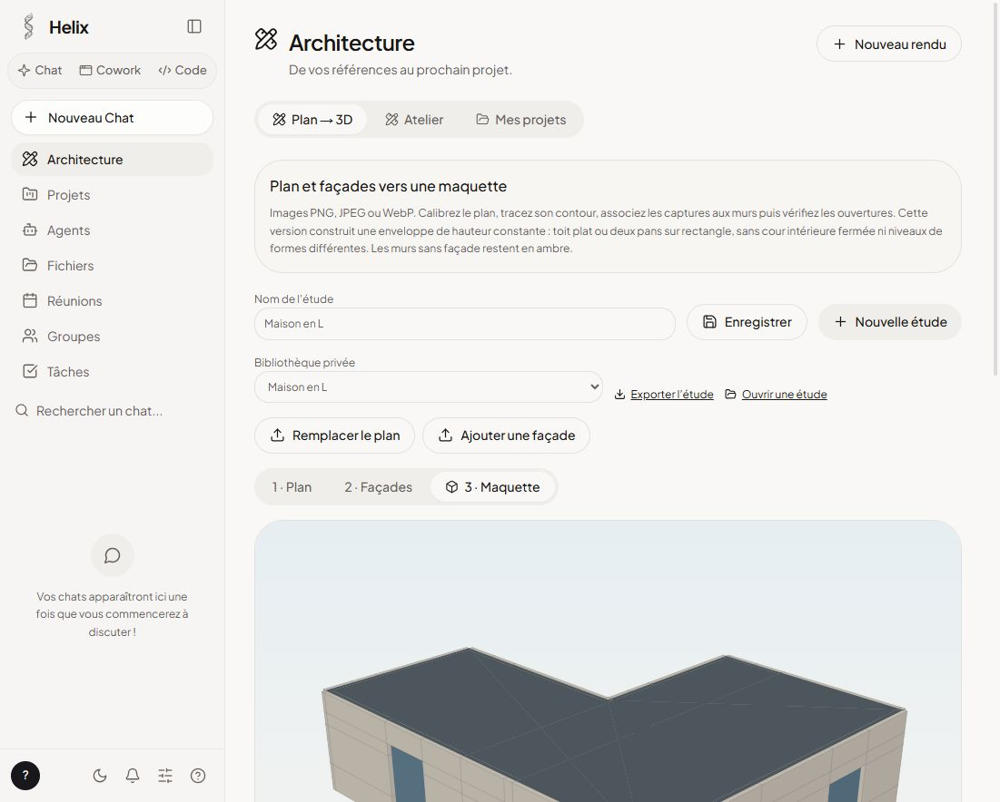

<p align="center"></p>

# HELIX — IA locale, retouche photo et architecture

Un espace de travail qui réunit conversation, génération et modification d’images, références de matériaux et maquettes issues de plans et d’élévations.

Ce dépôt contient la version de **NISMOR33**, dérivée de [HelixAI](https://github.com/medhiclb/HelixAI), avec les développements photo et architecture réalisés dans ce projet. La base HelixAI est l’œuvre de Medhi Clabaut / Helix Agence. Les attributions et la licence AGPL-3.0 sont conservées.

> **État du projet : version de développement.** La retouche locale et la maquette sont utilisables comme outils assistés. La reconnaissance automatique des plans n’est pas assez fiable pour produire un relevé architectural exact sans correction. Ce dépôt ne fournit pas, à ce stade, de nouvel installateur public ni de modèles préinstallés.

[Installation](#installation-depuis-les-sources) · [Chat et images](#chat-et-images) · [Architecture](#architecture) · [Tests](#tests) · [Limites](#limites-actuelles) · [Documentation](#documentation) · [Licence](#licence-et-origine)

## Ce que contient cette version

| Fonction | Comportement |
| --- | --- |
| Chat et délégation | Le routeur choisit discussion, réflexion, génération ou retouche selon le message et les images disponibles. |
| Retouche autonome | Le chat prépare la modification, appelle le moteur et renvoie l’image sans ouvrir l’atelier d’architecture. |
| Reprise d’une image | Une nouvelle pièce jointe est prioritaire ; sinon la dernière image de la conversation peut être réutilisée. |
| Attente visuelle | Carte animée, photo source si disponible et étapes annoncées par le moteur. |
| Atelier explicite | Cadrage, références, zones protégées ou modifiables, variantes et contrôle visuel. |
| Projets et palettes | Regroupement des études, matériaux de référence et scénarios. |
| Plan → 3D | Image de plan, échelle connue, contour, association des façades et correction des ouvertures. |
| Toitures composées | Plusieurs zones rectangulaires, faîtages indépendants, pignons et jonctions. |
| Vues et export | Perspectives, élévations parallèles, PNG, étude JSON et OBJ en mètres. |
| Base HelixAI | Chat, agents, code, connaissances et autres outils de la plateforme d’origine. Voir la documentation amont pour leur périmètre. |

## Aperçus

### Création d’image dans le chat



Cette capture montre les vrais composants dans un aperçu avec **API simulée**. Le fond animé est une attente visuelle, pas une image générée intermédiaire. L’image finale apparaît quand le moteur a terminé.

### Maquette dans l’onglet Architecture



Le bâtiment de cette capture est un cas géométrique **synthétique**, à calages connus. Il ne prouve pas une reconstruction automatique d’un bâtiment réel. Les photos personnelles et les captures de plans réels utilisées pendant le développement ne sont pas publiées ici.

## Installation depuis les sources

### Prérequis

- Node.js **24** et npm.
- Git pour récupérer le projet.
- Windows, macOS ou Linux pour développer l’interface ; le paquet de bureau utilise Electron.
- Une connexion pour télécharger les dépendances et, si nécessaire, les moteurs et modèles choisis.
- Pour la retouche et la planification visuelle : un moteur d’image local et un modèle de vision local compatibles, configurés séparément.

Les modèles ne sont pas inclus dans Git. Leur mémoire nécessaire dépend du profil, de la résolution et du matériel. Les diagnostics de l’application doivent être consultés avant une installation ; la présence d’une carte graphique ne garantit pas qu’un modèle donné y tienne.

### Récupérer et installer

```bash
git clone https://github.com/NISMOR33/HELIX.git
cd HELIX
npm ci
```

### Lancer l’application de bureau en développement

Dans un premier terminal :

```bash
npm run dev
```

Dans un second terminal, à la racine du même dépôt :

```bash
npm run app
```

Le premier lance Vite sur le port 5173 ; le second construit la passerelle puis lance Electron. Il faut laisser Vite actif pendant cette session de développement.

### Développer dans un navigateur

Pour travailler sur l’interface et la passerelle séparément :

```bash
# Terminal 1
npm run gateway

# Terminal 2
npm run dev
```

La passerelle utilise par défaut le port **8787**. Vite redirige les appels `/helix` vers cette passerelle. N’ajoutez pas une passerelle séparée si Electron en a déjà démarré une sur le même port.

Pour utiliser un autre port de passerelle dans PowerShell :

```powershell
$env:HELIX_GATEWAY_PORT = "8795"
npm run gateway
```

Puis, dans le terminal de Vite :

```powershell
$env:HELIX_GATEWAY_URL = "http://127.0.0.1:8795"
npm run dev
```

## Configurer les modèles locaux

Un exemple minimal, sans clé ni accès au réseau local, est fourni dans [helix.local.example.json](helix.local.example.json). Le profil complet de déploiement reste dans [helix.config.example.json](helix.config.example.json) ; il contient des options destinées à une instance partagée et ne doit pas être recopié tel quel pour une retouche privée.

Exemple PowerShell pour utiliser le profil local :

```powershell
Copy-Item helix.local.example.json helix.config.json
$env:HELIX_CONFIG = (Resolve-Path helix.config.json).Path
npm run gateway
```

Le profil local indique LM Studio à `http://127.0.0.1:1234/v1`. Démarrez son serveur local et chargez un modèle approprié. Un modèle de texte seul ne suffit pas à analyser une photo : la planification et la lecture de documents nécessitent un modèle avec vision.

Dans les essais de développement, la configuration utilisée associait notamment **Qwen3.5 9B** pour la vision et **FLUX.2 klein 4B quantifié** pour la retouche locale. Ce sont des configurations d’essai, pas des garanties de compatibilité universelle. Les licences des poids doivent être vérifiées auprès de leurs distributeurs avant téléchargement ou redistribution.

Le moteur de chat ne devient pas un générateur d’images par lui-même. La création et la retouche nécessitent aussi le moteur d’image configuré dans l’application. Consultez [le guide de retouche locale](docs/retouche-photo-locale.md) pour les profils, l’installation et les diagnostics.

## Chat et images

### Modifier une photo

1. Joignez la photo dans le chat.
2. Écrivez par exemple : « Remplace uniquement le revêtement de façade par du bois vertical. Conserve les fenêtres, les volumes et le jardin. »
3. Le routeur choisit la retouche et le planificateur analyse la demande.
4. Une carte d’attente apparaît. Le chat appelle le moteur, suit son travail et effectue le contrôle visuel.
5. Le résultat s’affiche avec le téléchargement et la possibilité de continuer la retouche. Le plan technique n’est pas recopié dans la réponse.

Pour une modification suivante, vous pouvez écrire « rends le bois plus sombre » sans joindre à nouveau l’image. Le routeur dispose de la dernière image de la conversation. Si aucune source n’est disponible, il doit demander une photo.

### Créer une image

Écrivez par exemple : « Crée une image d’une maison contemporaine dans une forêt. » Le routeur choisit la création. La carte d’attente ne prétend pas montrer des trames générées en direct : le moteur actuel ne les fournit pas.

Les erreurs de moteur et les avertissements importants restent visibles. La vérification visuelle est indicative ; elle ne garantit pas que tous les détails ont été conservés.

### Utiliser l’atelier volontairement

Ouvrez **Architecture → Atelier** pour régler les masques, zones, références, variantes et palettes. Ce parcours reste explicite. Une retouche ordinaire demandée dans le chat ne doit pas ouvrir cet atelier automatiquement.

## Architecture

### Retouche de façades et références

Vous pouvez joindre une cible et jusqu’à trois références, par exemple un échantillon de bois ou une ambiance. L’atelier permet de préciser les éléments à modifier et ceux à protéger.

Une consigne seule ne garantit pas la conservation des pixels. La préservation exacte hors des zones autorisées repose sur le masque appliqué au résultat. Les protections priment sur les zones modifiables ; vérifiez donc le masque avant un calcul important.

### Du plan à la maquette

Dans **Architecture → Plan → 3D** :

1. Importez une capture PNG, JPEG ou WebP du plan.
2. Posez les points A et B sur une distance connue et saisissez sa longueur réelle en mètres.
3. Tracez le contour extérieur dans l’ordre, sans répéter le premier sommet.
4. Associez une capture de façade au mur correspondant. Une vue d’ensemble doit être cadrée sur le mur concerné ; elle ne doit pas être étirée sur un seul mur si elle montre plusieurs volumes.
5. Vérifiez le sens gauche/droite, le cadre du mur et les rectangles des portes et fenêtres.
6. Corrigez les largeurs, positions, allèges et hauteurs en mètres.
7. Tracez les volumes de toiture rectangulaires et réglez chaque faîtage.
8. Comparez les perspectives et élévations parallèles, puis enregistrez ou exportez.

Le modèle de vision peut proposer un contour ou des ouvertures. Ils apparaissent en rouge, sans remplacer le tracé existant. Appliquez-les seulement après comparaison. Les captures CAO sombres sont préparées pour la lecture, mais cette préparation ne résout pas toutes les ambiguïtés.

Les directions est/ouest/nord/sud des vues suivent les axes du plan : elles ne déterminent pas son orientation géographique.

### Sauvegardes et formats

| Format | Contenu |
| --- | --- |
| Bibliothèque privée | Étude et liens vers les images du compte, avec contrôle de révision. |
| PNG | Vue du modèle ou résultat raster. |
| OBJ | Enveloppe géométrique en mètres, avec découpes des baies. |
| JSON | Calages et paramètres ; les images peuvent être incluses pour un import dans un autre compte. |

Sans images incluses, les identifiants d’un JSON restent liés aux données du compte et du poste d’origine. Une maquette incomplète nécessite une acceptation explicite de ses hypothèses avant export.

## Limites actuelles

- **Aucun import DWG/DXF natif** : le parcours décrit utilise des captures d’écran ou des images.
- La reconnaissance IA des plans reste imprécise. Elle peut inclure un abri, omettre un décrochement ou confondre du bardage et des véhicules avec des ouvertures.
- Une échelle connue ne fournit pas les hauteurs manquantes. Elles doivent être renseignées et confirmées.
- La maquette utilise une hauteur de murs commune. Les niveaux de contours différents, cours intérieures fermées, lucarnes et ouvertures de pignon ne sont pas pris en charge.
- Les zones de toiture doivent être rectangulaires, sans chevauchement et couvrir l’empreinte. Les jonctions ne constituent pas un calcul structurel.
- Les murs peuvent se recouper : l’OBJ n’est pas un solide BIM de fabrication ni un document d’exécution.
- Les façades cachées et l’abri voiture ne doivent pas être inventés pour compléter un dossier incomplet.
- Le rendu photographique IA est distinct de la maquette. Il peut modifier des détails et ne certifie pas la géométrie.
- Les derniers ajouts photo/architecture comportent encore des textes principalement français ; les traductions historiques de la plateforme ne couvrent pas nécessairement ces ajouts.

## Tests

```bash
npm run typecheck
npm run build
npm test
npm run test:http
```

`npm test` exécute les suites photo, maquette et chat autonome. Au dernier contrôle local : **40 tests unitaires réussis** et **60 vérifications HTTP réussies**.

Les contrôles HTTP lancent une passerelle locale avec des comptes et dossiers temporaires. Ils vérifient notamment la propriété des photos, l’isolation des études, les conflits de révision, les cadrages invalides et la fermeture des fonctions privées sur une instance partagée. Aucun modèle ne doit être téléchargé pour ces suites.

Le test du nouveau parcours client a aussi utilisé une API simulée : planification, suivi, vérification, résultat seul et zéro ouverture d’atelier. Une nouvelle retouche complète avec le moteur natif n’a pas été exécutée lors de la dernière modification du chat. Les essais unitaires ne remplacent pas un essai GPU réel.

La CI légère vérifie les types, la construction et les suites sans modèle. Les workflows historiques Windows et OpenClaw restent disponibles par déclenchement manuel ; ils peuvent télécharger des composants et des modèles volumineux.

## Construire un paquet de bureau

```bash
npm run package
```

Les sorties vont dans `release/`, ignoré par Git. La construction vise les plateformes configurées dans `package.json`, selon la machine et les outils de compilation disponibles. La validation récente de cette variante a été menée sous Windows ; elle ne certifie pas les paquets macOS/Linux.

Un empaquetage Windows sans clé d’éditeur, destiné à un essai local, peut être réalisé dans PowerShell :

```powershell
$env:HELIX_SANS_CLE_EDITEUR = "1"
$env:CSC_IDENTITY_AUTO_DISCOVERY = "false"
npm run build
npx electron-builder --win --dir --publish never
```

Pour une distribution signée, lire [SIGNATURE.md](SIGNATURE.md) et les scripts de `scripts/signature/`. Le contournement de clé ci-dessus n’est pas un substitut à une signature de distribution. Aucun certificat privé ni jeton de publication n’est fourni dans ce dépôt.

Le lanceur C# dans `scripts/lanceur-retouche-windows.cs` concerne la disposition de la livraison locale de développement. Il ne remplace pas la procédure standard Electron ci-dessus. Les exécutables et modèles présents sur le poste du développeur ne sont pas embarqués dans Git et aucune release publique de cette variante n’est annoncée ici.

## Confidentialité et configuration

Les fonctions privées de retouche sont limitées à une instance locale non partagée et à une séance authentifiée. Les images et maquettes sont vérifiées par propriétaire. Les données de l’instance sont normalement placées sous `~/.helix` ; `HELIX_DATA_DIR` permet de choisir un autre dossier.

Variables utiles :

| Variable | Usage |
| --- | --- |
| `HELIX_DATA_DIR` | Dossier des données de l’instance. |
| `HELIX_IMAGES_DIR` | Stockage utilisé par le moteur d’images. |
| `HELIX_CONFIG` | Chemin du profil de déploiement. |
| `HELIX_GATEWAY_HOST` / `HELIX_GATEWAY_PORT` | Adresse et port de la passerelle. |
| `HELIX_GATEWAY_URL` | Cible de la passerelle pour le proxy Vite. |
| `HELIX_DEV_URL` | URL de l’interface chargée par Electron en développement. |
| `HELIX_SANS_MISE_A_JOUR` | Désactivation des mises à jour dans la livraison personnalisée de développement. |

Les fichiers actifs de configuration, clés, comptes, jetons, conversations, photos privées, modèles et sorties de génération sont exclus de cette publication. Le profil d’exemple contient uniquement des valeurs de démonstration.

La plateforme peut aussi connecter des services distants. **« Local » décrit la configuration utilisée, pas une promesse pour toutes les fonctions et tous les fournisseurs.** Vérifiez les moteurs, connecteurs et options de recherche actifs avant d’utiliser des documents confidentiels. Voir [SECURITY.md](SECURITY.md), [SECURITE.md](SECURITE.md) et [ARCHITECTURE.md](ARCHITECTURE.md).

## Dépannage

| Symptôme | Vérifications |
| --- | --- |
| `Failed to fetch` à la connexion | Passerelle démarrée, port correct, URL du proxy Vite, ancienne instance encore ouverte et journal de la passerelle. |
| « Aucun modèle local » | Serveur local disponible, modèle chargé et rôle vision si une image est analysée. |
| Le chat refuse de générer | Le moteur d’image est installé/configuré ; un modèle de chat seul ne suffit pas. |
| Retouche indisponible en instance partagée | Utiliser le parcours privé sur une instance locale non partagée. |
| Ancien atelier ouvert à chaque demande | Redémarrer la nouvelle construction et vérifier que l’ancien exécutable n’est plus utilisé. |
| Fenêtres inversées | Vérifier le sens de la flèche du mur et l’option gauche/droite de la capture. |
| Toiture manquante ou chevauchement | Vérifier les rectangles, leur couverture de l’empreinte et les alertes. |
| Maquette disproportionnée | Vérifier A–B et les unités : une cote en centimètres doit être convertie en mètres. |
| Une photo d’étude ne s’affiche pas après import | Inclure les PNG dans l’étude ou utiliser les données du compte auquel les identifiants appartiennent. |

## Organisation du dépôt

```text
src/
  components/chat/          Conversation, images, attente et atelier
  components/architecture/  Calage des plans/façades et toitures
  pages/ArchitecturePage.tsx
  lib/                     Clients et géométrie déterministe
  hooks/useChat.ts          Orchestration du chat

gateway/src/               API, modèles, stockage et droits
electron/                  Application de bureau
cli/                       Commande Helix
extensions/                Extensions de la plateforme
scripts/                   Construction, tests et signature
docs/                      Guides et captures de démonstration
.github/workflows/         Vérifications et essais manuels
```

## Documentation

- [Fonctionnement photo et géométrie](docs/ARCHITECTURE-PHOTO.md)
- [Retouche photo locale](docs/retouche-photo-locale.md)
- [Architecture technique de la plateforme](ARCHITECTURE.md)
- [Guide général amont](docs/GUIDE.md)
- [README original conservé](README.upstream.md)
- [Composants et licences tierces](THIRD_PARTY_NOTICES.md)
- [Contribution](CONTRIBUTING.md)

Les documents historiques et traductions amont décrivent la plateforme d’origine ; ils peuvent mentionner ses téléchargements, services ou procédures. Ils ne constituent pas une annonce de releases ou de services fournis par ce dépôt.

## Contribuer

Les problèmes reproductibles et les contributions sont bienvenus dans [les issues](https://github.com/NISMOR33/HELIX/issues) et les pull requests. Indiquez le système, le modèle, le parcours suivi, le résultat attendu et le message d’erreur. Utilisez des données de démonstration ou anonymisées pour les captures et journaux publics.

Avant une modification importante, lisez `PROJET.md`, `ARCHITECTURE.md` et `CONTRIBUTING.md`. Ajoutez un test lorsqu’il permet de vérifier un comportement utile, puis exécutez les suites adaptées. Pour les problèmes de sécurité, suivez `SECURITY.md` plutôt que de publier des identifiants dans une issue.

Les prochains travaux concernent principalement la précision de lecture des documents, les volumes et niveaux plus complexes, la validation native de bout en bout du chat et une distribution publique reproductible.

## Licence et origine

Code sous **AGPL-3.0-only**, voir [LICENSE](LICENSE). Les copyrights et notices amont sont conservés dans [COPYRIGHT.md](COPYRIGHT.md) et [THIRD_PARTY_NOTICES.md](THIRD_PARTY_NOTICES.md). Cette version est une dérivation de HelixAI ; elle ne prétend pas avoir créé seule la plateforme d’origine ni être sa distribution officielle.

Les poids de modèles et moteurs externes peuvent avoir leurs propres licences. Aucun poids ni certificat de signature privé n’est redistribué ici.
